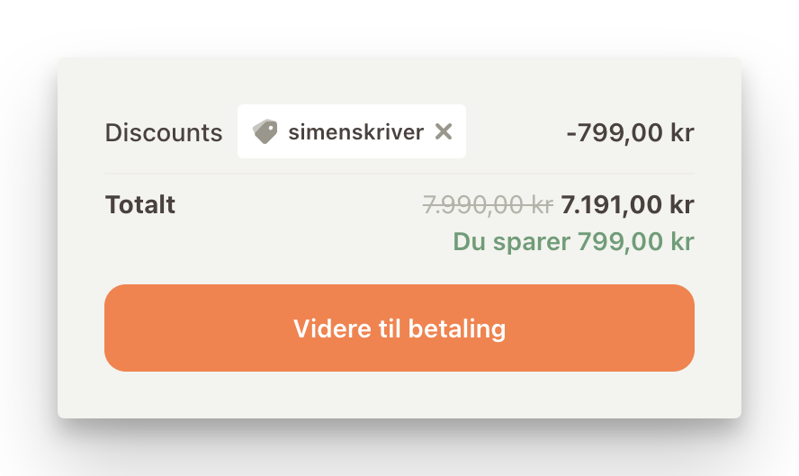

## Rabattkoder

Til nå er det seks tjenester jeg har egne rabattkoder til:

1. Smarte dumtelefoner, eller mer distraksjonsfri teknologi, fra [Romobil](https://romobil.no/discount/simenskriver) (koden «simenskriver» legges til automatisk)
2. [Cleanshot](https://cleanshot.sjv.io/simenskriver)
3. [Readwise](https://readwise.io/simenskriver/)
4. [Raycast](https://www.raycast.com/?via=simen)
5. [Ørepropper fra Loop](http://rwrd.io/5ndgmck?c)
6. [Lydboktjenesten Libro](https://libro.fm/referral?rf_code=lfm815936)

Tanken min er enkelt og greit at hvis det er en tjeneste jeg har brukt mye sjøl, og betaler for uansett, da vil en rabattordning være fint for begge parter. 

### Romobil

Akkurat sånn som avtalen er nå så skiller denne seg fra de andre. Du får 10 % avslag på alt som er der. Ikke noe fiks-faks. Og det er i grunn temmelig raust av [Thomas og Rikke som driver sjappa](https://www.nrk.no/artikkel/rebecca-kastet-iphonen-du-ser-livet-rase-forbi-1528146#doc-1k3ckchkg1), for det vil si at du får faktisk 800 kr avslag hvis du f. eks vil løsrive deg fra "big tech", og prøve deg på en [Volla pilnius-telefon](https://romobil.no/discount/simenskriver?redirect=/products/volla-pilnius).

Forskjellen er at *jeg* tjener ikke noe på at du bruker den linken. Det er det kun du som gjør. Det kan hende vi endrer på det etterhvert, at jeg får en liten del av kaka, og at du da får litt mindre, men da oppdaterer jeg iallefall denne teksten for å informere om det.

Jeg liker bare at jeg kan støtte en norsk bedrift som gjør det lettere å [ta vare på oppmerksomheten sin](oppmerksomhet.md). Og at de gjør det enkelt å angre seg:

> Vi tilbyr innbytte opptil 6 måneder etter kjøp. Avhengig av tilstand på telefonen, så mottar du et beløp du kan bruke på å velge en annen telefon hos oss.

### Alle de andre

[[klisterhjerne|Readwise]] betaler jeg 80 kr for hver måned. [[den-ene-funksjonen|Cleanshot]] kjøpte jeg for 290 kr (engangssum) med en gang jeg så det. Nettopp fordi jeg tar veldig mye skjermbilder, og fordi det gjør både jobb og hverdag lettere og morsommere. Og [[Raycast]] er utvilsomt den mest brukte appen min jeg har på dataen, og den betaler jeg gladelig 1000 kr i året for.

Øreproppene ([fra Loop](http://rwrd.io/5ndgmck?c)) syns jeg var gull verdt de første to månedene med en liten baby i huset. Bare for å kjøpe meg mer tålmodighet i de få øyeblikka hvor det er vanskelig å være en liten krabat.

[Libro](https://libro.fm/referral?rf_code=lfm815936) var vinneren av researchen min da jeg så etter en måte å komme i gang med lydbøker på. Det er mye å like med dem egentlig:
- Kan høre (og laste ned bøker til) Apple Watch, så jeg trenger ikke ha med telefonen, og framgangen i lydboka synkroniseres tilbake til telefonen
- Hver gang du kjøper en bok går noe av pengene til en lokal bokforhandler som du velger sjøl
	- Gitt at de har en avtale med Libro, som i praksis betyr at det er én bokhandel i Norge å velge mellom, men fint læææll
- Digg å kunne unngå å låse seg inne hos Amazon og Apple
- Som også betyr at du kan laste ned lydfilene og høre på dem i andre apper (som f. Eks Snipd, hvis jeg vil fortsette med flyten jeg har for min [[klisterhjerne|digitale klisterhjerne]])

Alle tjenestene har jeg fått mye ut av, og er blant de første tjenestene jeg tipser om hvis jeg skal dele noe kult og nerdete. Da føles det bare rett og rimelig og ha en rabattlink tilgjengelig.
